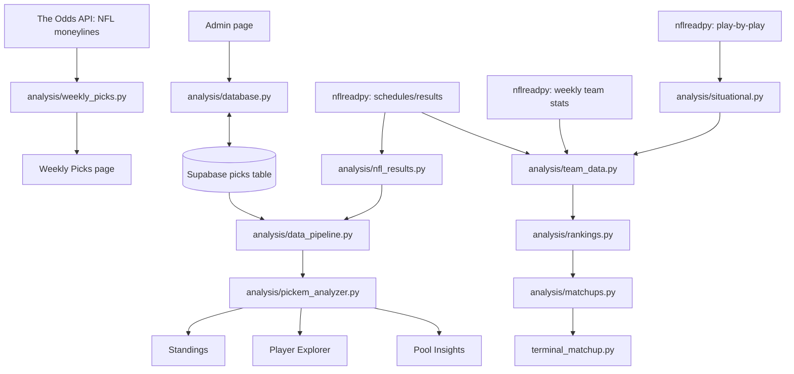

# NFL Confidence Assistant — Project Operations & Architecture Guide

**Source reviewed:** `NFL Confidence Assistant for review(5).zip` (October 2026 snapshot)  
**Scope:** Documentation of the supplied source, not a claim that the deployed app or external services were tested.  
**Project identity:** The README calls the product **NFL Pick'em Intelligence Dashboard**; the ZIP folder is named **NFL Confidence Assistant**. This guide uses the latter as the project name.

## Quick reference — start here after time away

| Goal | Action |
|---|---|
| Start the local dashboard | From the project root: `streamlit run app.py` |
| Install packages | `python -m pip install -r requirements.txt` |
| Build a confidence card | **Weekly Picks** → choose season/week → **Load Weekly Odds** → choose winners and arrange confidence order |
| Enter or correct pool picks | Log in using the sidebar → **Admin** → select season/week/player → fill picks and confidence → **Validate Picks** (validation also saves) |
| See current standings | **Standings**; its page builds results from stored picks and NFL schedules |
| Review a player | **Player Explorer** |
| Analyze pool behavior | **Pool Insights** |
| Generate matchup report | Edit `SEASON` and `WEEK` at top of `terminal_matchup.py`, then `python terminal_matchup.py` |
| Update play-by-play cache | See **Cache maintenance** below; there is no general-purpose refresh command exposed by the app |

> **Important discrepancy:** The README and Admin page text describe refreshing results, but the uploaded `pages/5_Admin.py` has **no dedicated Refresh NFL Results button**. The current page code validates and upserts picks. Other analytics pages retrieve results when rebuilding their data. Do not follow the older README's refresh-button instruction without verifying a newer code version.

## 1. Purpose and major subsystems

The dashboard supports an NFL confidence-pool workflow: choose game winners, compare confidence rankings against sportsbook market probabilities, persist pool participants' picks, calculate standings, and analyze player/pool patterns. The repository also includes a separate team-statistics and matchup-analysis engine used by standalone scripts.

The code divides into three broad areas:

1. **Weekly market guidance:** Odds API → no-vig consensus probabilities → recommended confidence ranking → interactive Weekly Picks page.
2. **Pool recordkeeping and analytics:** Streamlit Admin → Supabase `picks` table → nflverse game results → joined pick/game records → standings, player exploration, and pool insights.
3. **Team and matchup research:** nflverse weekly team stats, schedules, and play-by-play → team-game records and situational stats → team rankings → matchup comparisons and terminal reports.

### Architecture at a glance



This is a conceptual diagram. Some page modules call multiple analytics modules directly rather than passing through one exclusive chain.

## 2. Project directory map

```text
app.py                           Streamlit entry point, navigation, admin login
pages/
  1_Weekly_Picks.py              Odds loading, winner selection, confidence sorting
  2_Player_Explorer.py           Player performance interface
  3_Standings.py                 Overall and weekly standings
  4_Pool_Insights.py             Group behavior and market-performance views
  5_Admin.py                     Authenticated pick entry and Supabase upsert
analysis/
  database.py                    Supabase credentials, load, upsert
  data_pipeline.py               CSV templates/imports, validation, pick/result joins
  nfl_results.py                 NFL schedule/results for a given week
  weekly_picks.py                Odds API, probabilities, live pick ranking
  pickem_analyzer.py             Standings, confidence, consensus and pool measures
  player_explorer.py             Player-specific analytical summaries
  market_performance.py          Market-based performance calculations
  team_data.py                   Team-game statistical dataset
  situational.py                 Play-by-play cache, third-down and red-zone stats
  rankings.py                    Team metrics and rankings
  matchups.py                    Team-vs-team matchup comparisons
terminal_matchup.py              Standalone scheduled matchup report
nfl_confidence.py                Additional standalone confidence tool
analyze_*.py / query_*.py        Targeted research/diagnostic scripts
upset_analysis.py                Upset research script
upset_backtest.py                Upset backtesting script
streamlit_player_explorer.py     Additional standalone explorer implementation
research/archive/               Archived exploratory queries
tests/                          Validation and test scripts
assets/                         UI illustrations
data/                           Local templates, imports, archive, CSV snapshots
README.md                       Short project overview (some operational details stale)
requirements.txt                Declared runtime dependencies
.gitignore                      Excludes .env, Streamlit secrets, venv and pycache
```

The ZIP also includes dated CSV exports and individual one-off scripts such as `temp.py`, `query_lone_wolves.py`, and `query_seattle_denver.py`. Treat these as auxiliary until their intended use is individually verified; they are not part of the default Streamlit navigation.

## 3. Environment and startup

### Requirements

The supplied `requirements.txt` lists `streamlit`, `pandas`, `requests`, `python-dotenv`, `nflreadpy`, `streamlit-sortables==0.3.1`, and `supabase`. The play-by-play code reads and writes Parquet, which requires an available pandas Parquet engine such as `pyarrow`; **the provided requirements file does not explicitly list `pyarrow`**. If Parquet operations fail, check the installed environment and add the required engine deliberately.

### Local setup

From a terminal in the extracted project root:

```powershell
python -m venv .venv
.venv\Scripts\Activate.ps1
python -m pip install -r requirements.txt
streamlit run app.py
```

On Windows Command Prompt, activation is `.venv\Scripts\activate.bat`. The exact Python version is not pinned in the supplied requirements.

### Secrets and credentials

- `analysis/database.py` reads `SUPABASE_URL` and `SUPABASE_SECRET_KEY` from environment variables (loaded from `.env`) or Streamlit secrets.
- `analysis/weekly_picks.py` reads `ODDS_API_KEY` from environment variables or Streamlit secrets.
- `app.py` checks `st.secrets["admin_password"]` for sidebar Admin login. **This specific login is read from Streamlit secrets**, not from `os.getenv`.
- Keep `.env` and `.streamlit/secrets.toml` out of Git. Never include real credentials in shared ZIP archives or documentation.
- The Supabase table name in code is `picks`. The upsert conflict key is `season,week,player,game_id`; the database must support that uniqueness constraint for intended upsert behavior.

### Start the app

```powershell
streamlit run app.py
```

`app.py` initializes the admin-authenticated session flag, renders the home screen, and uses `st.navigation` with the public pages. It adds `pages/5_Admin.py` only when the sidebar password check succeeds. Logging out clears the session flag.

## 4. Weekly Picks: market-based confidence recommendations

**Page:** `pages/1_Weekly_Picks.py`  
**Engine:** `analysis/weekly_picks.py`

1. Select season and week (the supplied UI offers 2026 and weeks 1–18).
2. Click **Load Weekly Odds**. The engine obtains the week's games/time window and requests NFL head-to-head odds from The Odds API.
3. Choose winners and arrange them in confidence order using `streamlit-sortables`.
4. The engine converts American moneylines to implied probabilities, removes the two-sided bookmaker margin where applicable, aggregates sportsbook probabilities, and derives a market ranking.
5. Compare personal and recommended confidence assignments and inspect differences.

Relevant functions include `get_week_nfl_odds`, `get_consensus_probabilities`, `no_vig_probabilities`, `rank_live_picks`, `confidence_tier`, and `summarize_pick_profile`.

**Caution:** This page is an odds-based decision aid, not a guaranteed prediction model. Availability of odds depends on the external API, the selected week, and the API key/quota. The page's loaded odds are held in Streamlit session state; do not confuse them with saved player picks in Supabase.

## 5. Admin: entering the actual pool selections

**Page:** `pages/5_Admin.py`  
**Storage:** `analysis/database.py` → Supabase `picks`

1. Log in using the sidebar Admin login.
2. Open **Admin**, choose season/week and one of the hard-coded players (`Jimmy`, `John`, `Jesse`).
3. The page calls `fetch_week_results` to populate the schedule and `load_picks` to prefill that player's existing selections.
4. Enter a team and confidence value for each game.
5. Click **Validate Picks**. The page checks for missing pick/confidence pairings and duplicate confidence values; if validation passes and at least one pick was entered, it **immediately calls `upsert_picks` and saves to Supabase**.
6. The upsert updates existing rows with the same season/week/player/game ID, rather than blindly appending duplicates.

**Important:** The button is labeled **Validate Picks**, but successful validation also writes data. Treat it as a save operation. The file defines a `destination_file` path for a local CSV but does not write to it in the inspected submission path.

**Current limitations:** The Admin season and player choices are hard-coded in this snapshot. The page contains no actual standalone refresh-results button despite its explanatory text.

## 6. Results pipeline: from picks to scored outcomes

### Source of truth

- **Picks:** Supabase `picks` rows; database fields include `season`, `week`, `player`, `game_id`, `pick`, and `confidence`.
- **Game results:** `analysis/nfl_results.py::fetch_week_results(season, week)` calls `nflreadpy.load_schedules` and filters to the selected regular-season week.
- **Master analytical records:** `analysis/data_pipeline.py::build_master_results_from_supabase()` loads picks, renames database `pick` to `picked_team`, groups picks by season/week, and calls `build_results_from_picks` for each group.

`fetch_week_results` marks a game completed when both scores are non-null, labels it `final`, identifies ties, and assigns the winner only for a non-tied completed game. **This implementation infers final status from score availability**, rather than reading an authoritative live game-status field; be cautious with in-progress data if upstream schedules populate scores before a game ends.

### File-based alternatives

`data_pipeline.py` also contains functions to generate weekly CSV templates, load/import/validate pick files, append/upsert pick rows in files, and build/save a master CSV. These coexist with the Supabase path; they should not be mistaken for the primary deployed persistence mechanism.

`save_master_results_from_supabase(output_filepath="data/picks_results.csv")` writes a **local snapshot** of the rebuilt master table. The normal analytics pages call `build_master_results_from_supabase` directly; they do not need to read that snapshot.

### What each page does with the master table

- **Standings:** `overall_standings`, `weekly_results` from `pickem_analyzer.py`.
- **Player Explorer:** `get_player_explorer` and supporting division/opponent summaries from `player_explorer.py`.
- **Pool Insights:** confidence-level and ranking efficiency, pool game results, lone-wolf and unanimous picks, collective disasters/triumphs, team trust, agreement, plus market-performance summaries.

## 7. Team statistics, rankings and matchup engine

This is a **parallel analytical workflow**, not a requirement for entering picks or viewing standings.

- `analysis/team_data.py::load_team_games(season)` loads weekly team statistics via `nflreadpy.load_team_stats`, constructs per-game offensive measures, pairs opponents to derive defensive measures, merges schedules and situational data, and produces team-game rows.
- `analysis/situational.py::load_pbp_data(season)` loads play-by-play data from a local Parquet cache if present, otherwise downloads nflverse play-by-play and saves a cache. `load_third_down_stats` and `load_red_zone_stats` derive situational metrics.
- `analysis/rankings.py::get_team_rankings(team_games, season, through_week)` aggregates team performance through the chosen cutoff and calculates metric ranks. `STAT_CONFIG` controls ranking metric definitions.
- `analysis/matchups.py` contains `get_matchup_comparison`, `get_scheduled_matchup_comparison`, and `get_matchup_profiles` to compare teams and build matchup context.

### Running the terminal report

At the top of `terminal_matchup.py`, edit:

```python
SEASON = 2026
WEEK = 6
```

Then run:

```powershell
python terminal_matchup.py
```

The script fetches that season's team-game data and schedule, then prints each scheduled matchup. It rejects Week 1, because it requires previous regular-season games for a pregame comparison. For Week N, its matchup logic is intended to use information available **before** Week N; verify the cutoff if changing the matchup implementation.

### Cache maintenance

The play-by-play cache path is `data/pbp_<season>.parquet`, relative to the working directory. `load_pbp_data` prefers this existing file, so a cache may become stale as the season progresses. To explicitly replace it, from the project root:

```powershell
python -c "from analysis.situational import refresh_pbp_data; refresh_pbp_data(2026)"
```

`refresh_pbp_data` downloads fresh play-by-play data and overwrites that season's Parquet file. **Code-level detail to verify:** `load_pbp_data` filters downloaded data to `season_type == "REG"`, whereas `refresh_pbp_data` writes the returned play-by-play without that same explicit filter. That difference may affect downstream assumptions and deserves a test before treating the two paths as interchangeable.

## 8. Standalone research scripts and tests

The root contains scripts such as `analyze_jimmy_market.py`, `analyze_john_market.py`, `analyze_john_picks.py`, `analyze_league_underdogs.py`, `analyze_underdog_matchups.py`, `query_lone_wolves.py`, `query_seattle_denver.py`, `upset_analysis.py`, and `upset_backtest.py`. The `research/archive` folder contains older exploratory queries. The `tests` folder contains numerous test scripts.

**Operational rule:** These are not automatically part of the Streamlit app. Before running one, inspect its imports, top-level execution, hard-coded season/week/player settings, output paths, and whether it writes files. Their exact behavior has not been exhaustively audited in this guide. Do not assume every root-level script is safe to run without side effects.

## 9. Routine weekly workflow

**Before games:** Open Weekly Picks, load available odds, choose winners and confidence order; compare against market. Enter each participant's actual selections through Admin. Because Validate Picks saves, double-check entries before submitting.

**During games:** The source of outcomes is the nflverse schedule data. If analytics look stale, rerun the relevant Streamlit page and verify whether the upstream schedule has updated. Do not assume the Admin page contains a refresh control.

**After games:** Review Standings, Player Explorer, and Pool Insights. If you need a saved local export, invoke `save_master_results_from_supabase` deliberately from the project root (see below).

**Before the next slate:** Set the upcoming week in `terminal_matchup.py`, run the report, and consider refreshing the play-by-play cache first if situational metrics should include the latest completed games.

### Optional: export the Supabase-backed master dataset

```powershell
python -c "from analysis.data_pipeline import save_master_results_from_supabase; save_master_results_from_supabase()"
```

This writes `data/picks_results.csv`. It is an export/snapshot, not a Supabase update.

## 10. Troubleshooting

| Symptom | Check |
|---|---|
| `streamlit` command not found | Activate the intended virtual environment and install `requirements.txt` |
| Missing Supabase credentials | `.env` or Streamlit secrets contain `SUPABASE_URL` and `SUPABASE_SECRET_KEY` |
| Admin login fails/errors | `admin_password` exists in Streamlit secrets; check password and app secrets configuration |
| Weekly Odds fails to load | `ODDS_API_KEY`, API quota, week selection, and external endpoint availability |
| No picks / empty standings | Supabase `picks` table, selected season/week, game IDs, and whether any games have completed |
| Pick entry rejects submission | Missing team/confidence pair or duplicate confidence values |
| Game outcomes seem wrong/incomplete | Check source schedule scores and whether a game is actually final; score presence is the code's completion heuristic |
| Matchup report rejects Week 1 | Week 1 intentionally unsupported in `terminal_matchup.py` |
| Team stats appear stale | Check `data/pbp_<season>.parquet`; refresh only if appropriate |
| Parquet read/write fails | Check pandas Parquet engine installation (e.g., `pyarrow`) |
| Missing `data/` files | Run from project root; many paths are relative to the current working directory |

## 11. Maintenance and documentation issues to revisit

1. **Admin refresh mismatch:** README and page text advertise refreshing results, but no corresponding button is implemented in the uploaded Admin file.
2. **Validation saves immediately:** The button label does not clearly indicate a database write.
3. **Game completion heuristic:** `nfl_results.py` equates non-null scores with completion; verify behavior for live games.
4. **PBP cache filtering inconsistency:** Initial download filters to regular season; explicit refresh does not apply the same filter in the inspected function.
5. **Parquet dependency:** `pyarrow` is not explicitly pinned in `requirements.txt`.
6. **Hard-coded choices:** Admin player list and 2026 season selection need manual updates for future seasons/participants.
7. **README drift:** The README does not fully describe the expanded team-statistics/matchup research subsystem and may describe older operations.
8. **Research script catalog:** A future appendix can inspect each standalone query's inputs, outputs, and side effects individually.
9. **Automated validation:** Test scripts are present, but this review did not execute the full test suite or external-service integration tests.

## 12. Suggested return-to-project checklist

- [ ] Open this guide and confirm the intended season/week.
- [ ] Activate the environment and launch `streamlit run app.py`.
- [ ] Check external credentials without exposing their values.
- [ ] Open Standings to confirm Supabase picks and schedule results load.
- [ ] If entering picks, remember that **Validate Picks also saves**.
- [ ] If doing matchup analysis, set `SEASON` and `WEEK` in `terminal_matchup.py`.
- [ ] If using situational statistics, check whether the play-by-play cache needs updating.
- [ ] Review research scripts before running; do not confuse them with the live app.

---

**Documentation confidence:** File paths, function names, imports, UI labels, and behaviors above were inspected from the uploaded ZIP. External service connectivity, runtime behavior in deployment, and the complete set of one-off research scripts were not independently executed or exhaustively validated. This is a useful first version of the owner's manual, with explicit follow-up verification points rather than ungrounded claims.
